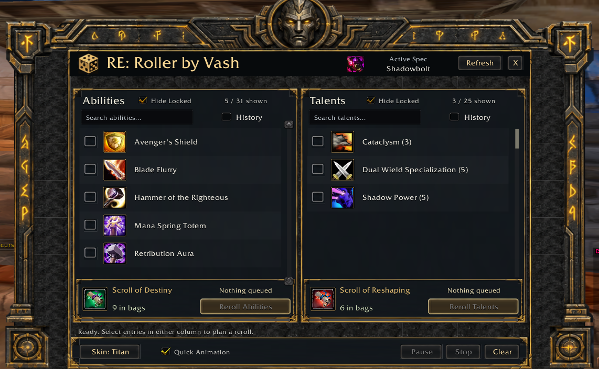
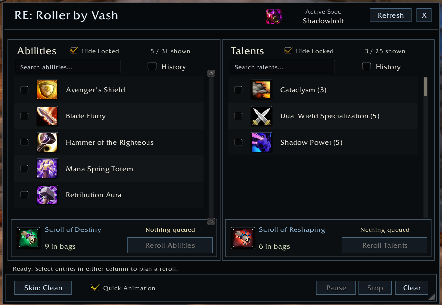
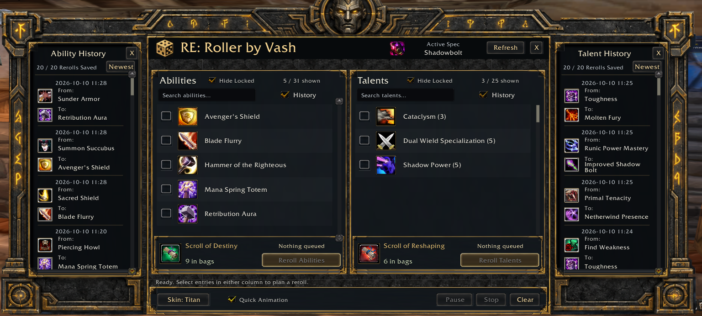
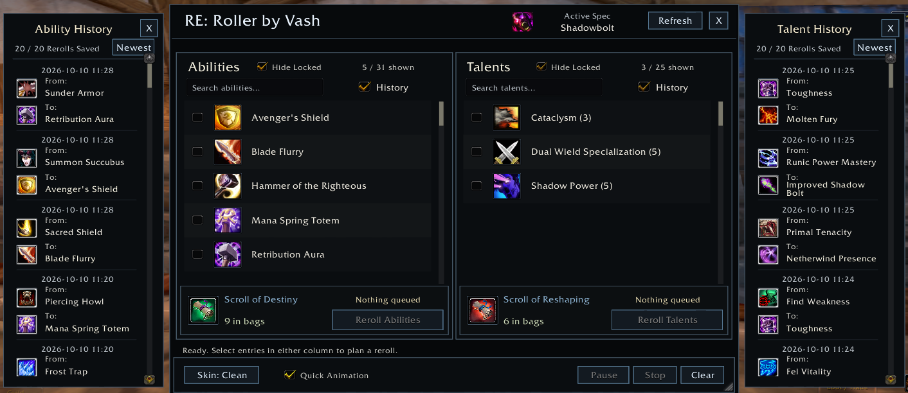

# RE: Roller by Vash

**Choose what changes. Protect what matters.**

A side-by-side ability and talent reroll planner for **Grimfall's custom World of Warcraft 3.3.5a client**, with a gold-and-stone **Titan** skin or a plain **Clean** interface.

[**Download Addon Only — Ready to Install (0.9.7)**](https://github.com/BarronZeta/RE-Roller/releases/download/v0.9.7/RE-Roller-0.9.7.zip)

Unzip, then copy the **`GrimfallReroll`** folder into your game's **`Interface/AddOns`** folder. This player download contains only the addon and its required assets/license notices—no tests, development tools, or preview images.

**Use the download link above for installation.** GitHub's **Code → Download ZIP** and **Source code** links are project archives, not the ready-to-install player download. The separate checksum and manifest downloads are optional; players only need the addon ZIP.

[All releases](https://github.com/BarronZeta/RE-Roller/releases) · [Installation](#installation) · [Report a bug](https://github.com/BarronZeta/RE-Roller/issues/new/choose)

**What's new in 0.9.7:** batch initial/final build reads, Titan/Clean appearance
selection, a compact controls-only footer, smaller history rows, and separate
20-roll ability/talent histories. Newly verified replacements no longer inherit
dormant current-spec locks. See the [release notes](docs/releases/0.9.7.md) and
[performance test guide](GrimfallReroll/PERFORMANCE-TEST.txt).

> **Compatibility:** Grimfall only. This addon relies on Grimfall's custom classless APIs; it is not a Retail, Classic, or generic WotLK addon. A release does not guarantee compatibility with every future client update.

## Screenshots

Live in-game screenshots of **0.9.7**, supplied by Vash and published unchanged.
Click any image to view it full size. Skin and history visibility are independent:
either appearance supports both history panels, one panel, or neither.

| | Titan skin | Clean appearance |
| --- | --- | --- |
| **History hidden** |  |  |
| **History shown** |  |  |

Use **Skin: Titan / Skin: Clean** in the bottom bar to change appearance. Use
each column's **History** checkbox to show or hide its side panel. Screenshots
are documentation only and are not included in the addon ZIP.

## What it does

- Browse your learned **Abilities** and **Talents** side by side, with search and hover tooltips.
- Select several entries and reroll them through a sequential batch. Lists refresh after final verification, not between rolls.
- Use **separate reroll buttons and scroll budgets** for abilities and talents.
- Right-click an entry to lock it against accidental selection. Locks are saved separately for each character and specialization slot.
- Turn on **Hide Locked** independently in either column to focus on the entries you want to change.
- Open scrollable **Ability History** and **Talent History** panels to review what rolled off and what replaced it. Hover either spell's icon or name for its tooltip.
- See your current custom specialization's name and icon when Grimfall provides them.
- Use **Quick Animation**, Pause/Resume, Stop and Clear in a compact controls bar.
- Receive confirmed roll results in **chat**, with old/new spell names, icons and scroll cost, without a floating announcement overlay.
- Move and resize the planner; drag its small launcher anywhere on screen.
- Choose **Titan** artwork or a plain **Clean** appearance; your choice is saved.

| Reroll type | Required item | Item ID |
| --- | --- | --- |
| Ability | Scroll of Destiny | 640 |
| Talent | Scroll of Reshaping | 639 |

The queue budgets one scroll per selected entry and checks the actual result before proceeding. It does not make rerolls free or guarantee a particular outcome.

## Installation

1. Close WoW.
2. [**Download the addon-only ZIP**](https://github.com/BarronZeta/RE-Roller/releases/download/v0.9.7/RE-Roller-0.9.7.zip). You do not need any other downloads.
3. Unzip it and copy the **`GrimfallReroll`** folder into your Grimfall game's `Interface/AddOns` directory. Alternatively, extract the ZIP directly into `Interface/AddOns`.
4. Check that the final path is `Interface/AddOns/GrimfallReroll/GrimfallReroll.toc`. If your unzip program creates an extra `RE-Roller-0.9.7` folder, move only the `GrimfallReroll` folder inside it—not that extra outer folder.
5. Start WoW and enable **RE: Roller by Vash** in the character-selection AddOns list.
6. Enter the game and type **`/rr`**, or click the dice launcher.

### Updating an existing installation

With WoW closed, back up your existing `GrimfallReroll` addon folder **and**
`WTF/Account/<account>/SavedVariables/GrimfallReroll.lua` (plus `.lua.bak`, if
present), then replace only the addon folder with the one from the release ZIP.
If Windows stores your game settings under VirtualStore, back up the actual
saved-variable files there too. **Do not delete your `WTF` folder or
`GrimfallRerollDB` saved variables.** Those contain your settings, protection
locks, and history. Keep backups local; do not upload account files to GitHub.

**0.9.7 keeps the newest 20 ability rolls and 20 talent rolls per character.**
Older entries are pruned when the addon loads. Make the backup first if you want
to keep your full older history; the downloadable addon does not create it for you.

The internal folder remains **`GrimfallReroll`** for compatibility. Do not rename it to `RE-Roller`.

## Using the planner

1. Search or scroll to the ability or talent you want to change.
2. **Left-click** its row or checkbox to select it.
3. **Right-click** anything you want to keep to lock it. Locking is immediate; unlocking asks for confirmation.
4. Check the selected count and available scrolls in that column.
5. Click **Reroll Abilities** or **Reroll Talents**. The other column's selection and scroll budget do not block that button.

**Pause** waits for any request already sent and pauses subsequent requests. Click it again to resume. **Stop** or closing the planner prevents further requests; an already submitted reroll cannot be recalled. Its confirmed result can still be recorded.

**Clear** clears the current selection. It does not erase history or remove protection locks.

### Hide Locked

Use the checkbox beside either section heading to hide that section's protected entries. Both filters default to off, are remembered independently, and work together with search. Turn a filter off to see and unlock a protected entry again.

Protection locks belong to each **character + realm + specialization slot**. The Hide Locked switches themselves are display preferences shared across specializations; they always filter using the active specialization's locks.

Version 0.9.2 verifies the live spec before lock, unlock and selection clicks, rejects outdated rows, and expires unlock popups after a spec switch. Existing protections are not reset: if an entry is already saved as locked on two specs, it remains locked on both. To remove an unwanted lock, activate the intended spec, click **Refresh**, uncheck **Hide Locked** if necessary, and right-click that entry to confirm **Unlock**.

### History and announcements

The **History** checkbox in each column opens its corresponding side panel. Scroll with the mouse wheel or scrollbar; **Newest** returns to the latest entry. Each confirmed record shows **From** and **To**, with separate spell tooltips.

History retains the newest **20 ability rolls and 20 talent rolls per character**, shared across that character's specs. Older saved entries are pruned at load; back up SavedVariables before upgrading if you need the old history. The footer contains only Skin, Quick Animation, Pause, Stop and Clear.

Confirmed rerolls send one **chat notification** with both spell icons, old-to-new names and the scroll cost. There is no floating announcement or duplicate Recent Transformations area. Both compact history panels remain available. Batch mode commits confirmed history and chat after final verification; stopping a batch still verifies any completed results.

### Commands

| Command | Action |
| --- | --- |
| `/rr` | Open or close the planner |
| `/rr help` | List commands without changing the window or queue |
| `/rr stop` | Stop sending further reroll requests |
| `/rr batch on` / `/rr batch off` (0.9.7) | Batch initial/final verification (default) / complete per-roll verification; change while idle |
| `/rr icon` | Restore the launcher to its default position |
| `/rr skin clean` / `/rr skin titan` (0.9.6) | Switch appearance instantly and save the choice |
| `/rr skin` (0.9.6) | Print the current appearance choice without opening or closing the window |
| `/rr diagnose` | Check required Grimfall APIs and show the current diagnostic status |
| `/rr performance` or `/rr perf` | Print session build-scan and redraw timings, plus frame gaps observed while rolling |
| `/rr pace` (0.9.5) | Print current queue status and the last five confirmed rolls' phase timings |
| `/rr perf reset` | Reset timing counters while no scan/roll is outstanding |
| `/rr smooth off` / `/rr smooth on` | Synchronous / frame-spread display refresh, for this session only |
| `/rr refresh sync` | One full synchronous refresh while no reroll is outstanding |
| `/rr history` | Print up to 20 recent history entries in chat |

`/reroller`, `/rerolls`, and `/grr` are aliases for `/rr`.

From 0.9.4, unknown commands print help without closing the window or stopping
the queue. Command case and extra spaces are accepted. The command is **perf**,
not **pref**; reset only clears counters, while `/rr perf` prints in chat.

### Batch reads and compact controls (0.9.7)

A six-roll batch normally makes **two full build reads total**: one fresh
startup read, then final verification after all six native result presentations.
Lists stay fixed during the batch. Every request still requires its result
event, exactly one matching scroll consumed, and the native presentation to
finish before the next request. Replacements are not added to the queue.

The trade-off is that **outside build changes are fully checked at the end**,
not before every request. Avoid manual build changes and other reroll tools
during a batch. Combat, death, spec changes, protected entries, blocked actions,
unexpected scroll changes and ambiguous results stop further requests. A stale
final build can require a bounded verification retry; no reroll is resent.
Use `/rr batch off` if you prefer the original full per-roll checks.

The header has more breathing room, the bottom is a controls-only bar, and
history icons/rows are smaller. Newly confirmed replacement entries no longer
inherit dormant current-spec locks; existing learned protections and other
specs remain intact. Already-hidden entries need a one-time manual unlock.

243 offline checks pass, including both six-roll paths, event-loop behavior,
exact inventory deltas, final build validation, independent 20-entry limits,
and the retained per-roll fallback. Offline work-count improvements are not
measured live-game speed or FPS gains. Full native reads can still hitch at
startup/finalization. The screenshots show the live interface, not a performance
benchmark.

### Appearance options (introduced in 0.9.6)

Click **Skin: Titan / Skin: Clean** beside Quick Animation, or use the commands
above. Titan remains the default. Clean replaces the guardian, stone pillars,
plinths, textured panel fills and decorative trim with plain dark panels and
thin borders. Spell icons, locks, selections, both lists, scrollable history,
and all queue controls remain available.

The choice is saved account-wide and switches without a reload. Changing it
does not scan the build, start/stop a queue, alter scroll use or clear saved
data. Frame fitting uses the smaller Clean bounds and restores Titan margins
when switched back. Artwork files remain available; there is no claimed FPS
gain or change to the cost of native game APIs.

### Pacing and diagnostics

The included pacing changes reduce the minimum gap from 600 to 100 ms, with
50 ms active readiness polling and next-frame event wakeups. The next request
still waits for the preceding result, exact scroll delta, and native presentation.
Actual spacing can be longer because of the client, server, or a manual pause.

`/rr perf` reports build reads, batch acknowledgement, redraw work and observed
frame gaps. `/rr pace` shows queue status and recent roll timings. Timings overlap
and are not pure server latency. For your next intended queue, wait for the
initial display read, run `/rr perf reset`, roll, then collect both reports.
Do not spend scrolls just to produce diagnostics.

Window opening, Refresh and idle build updates retain the frame-spread read-only
display scans introduced in 0.9.3. An individual native API call cannot be split
or interrupted. `/rr smooth off` restores synchronous display refresh for the
session; it is separate from the `/rr batch` queue option. See the
[changelog](CHANGELOG.md) for earlier fixes and version-specific test counts.

## Fonts and requirements

There are **no required companion addons**. RE: Roller uses **Friz Quadrata**, included with WoW, throughout the planner. Bundled **PT Sans** is the fallback if the game font cannot load; its license is included. Emblem and other addons' font registrations are no longer used. No global game fonts or other addons' files are changed.

Quick Animation only shortens the presentation for this addon's pending reroll. It preserves the client's result callbacks and does not bypass server confirmation or scroll costs.

## Troubleshooting and support

- **Nothing appears in the AddOns list:** check the folder nesting and the `.toc` path above.
- **A locked entry disappeared:** turn off Hide Locked and clear the search box.
- **The reroll button is unavailable:** check that you selected unlocked entries, have enough of that column's scrolls in your bags, are alive and out of combat, and have no pending result.
- **The queue stops:** read the planner's status line, then use `/rr diagnose`. The addon stops on uncertain results, server errors, or changes to your build instead of blindly sending another request.
- **Rolling stutters or freezes:** include `/rr perf` and `/rr pace` with your report, and say whether the hitch happened at startup, between rolls, or at the end. Frame gaps include the entire game and other addons; they do not identify the cause on their own. Batch mode removes intermediate full reads, but native startup/final reads may still hitch. No measured live FPS gain is claimed.
- **New replacements are hidden:** 0.9.7 prevents dormant same-spec locks from being inherited by newly verified replacements. Already-hidden entries are not retroactively unlocked; turn off Hide Locked and explicitly unlock the intended entry once.

[Report a bug](https://github.com/BarronZeta/RE-Roller/issues/new/choose) with your version, reproduction steps, and the exact error/status message. Screenshots help; crop private chat or account details. Do not upload your whole `WTF` folder or account files.

## Development

The addon source is in `GrimfallReroll/`. See [Development and testing](docs/DEVELOPMENT.md), [Contributing](CONTRIBUTING.md), and [Changelog](CHANGELOG.md).

Tests use mocked game APIs and never connect to a game server or consume scrolls. Offline tests and previews do not replace in-game verification on Grimfall.

## License and credits

Original code, tests, scripts, and documentation are licensed under [MIT](LICENSE), copyright 2026 Vash. Bundled ParaType fonts remain under their included SIL Open Font License. See [Third-party and asset notes](GrimfallReroll/THIRD_PARTY_NOTICES.txt).

RE: Roller is a community addon by Vash. It is not an official Blizzard product and does not claim endorsement by Blizzard or Grimfall.
